<a href="https://heyresearch.xyz">
  <picture>
    <source media="(prefers-color-scheme: dark)" srcset="assets/hero-dark.svg">
    
  </picture>
</a>

  <a href="https://heyresearch.xyz">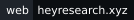</a>
  
  
  <a href="https://www.npmjs.com/package/@hey-research-lab/sdk">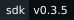</a>
  <a href="https://heyresearch.xyz/data">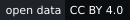</a>

  <b>Reads</b> the code, releases and deployments of teams building on Robinhood Chain, and now Base. 
  <b>Answers</b> one question with evidence: who is still building, and what did they ship? 
  <b>Links</b> every claim to its source. Price is context, never the verdict. Free, no wallet, nothing for sale.

  <a href="#robinhood-chain-live">The chain, live</a> ·
  <a href="#security-credits">Security</a> ·
  <a href="#fixes-we-sent-upstream">Fixes upstream</a> ·
  <a href="#built-on-hey">Built on HEY</a> ·
  <a href="#use-it">Use it</a>

<picture>
  <source media="(prefers-color-scheme: dark)" srcset="assets/stats-dark.svg">
  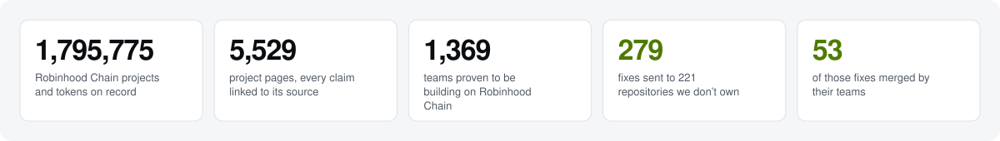
</picture>

## Robinhood Chain, live

<picture>
  <source media="(prefers-color-scheme: dark)" srcset="assets/chain-dark.svg">
  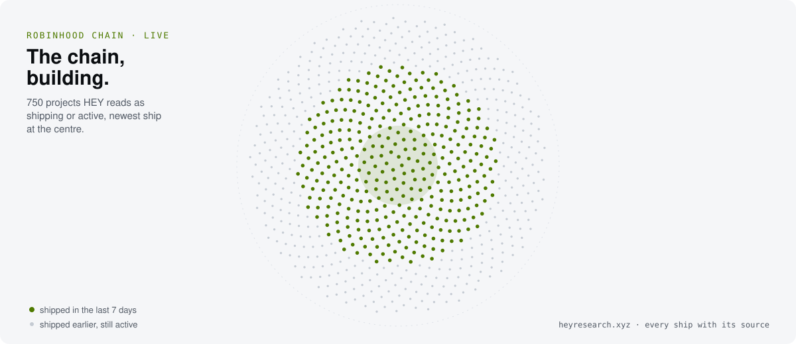
</picture>

<picture>
  <source media="(prefers-color-scheme: dark)" srcset="assets/launches-dark.svg">
  
</picture>

<picture>
  <source media="(prefers-color-scheme: dark)" srcset="assets/ships-dark.svg">
  
</picture>

Redrawn every day from [heyresearch.xyz](https://heyresearch.xyz)'s public API. Browsing HEY needs no wallet, and nothing on it is for sale.

**Base:** [heyresearch.xyz/base](https://heyresearch.xyz/base) lists 134 Base builders, each checked by hand with the source for its Base evidence; each one's latest ship is read every day from its GitHub releases. Robinhood Chain stays home; daily tracking of Base starts in early December.

## Security credits

When we find something that could put funds at risk, it goes to the team privately first, through their own channel.
We publish nothing until they do. How we report, and the teams that fixed what we found:
[github.com/hey-research-lab/security](https://github.com/hey-research-lab/security).

<a href="https://github.com/hey-research-lab/security">
  <picture>
    <source media="(prefers-color-scheme: dark)" srcset="https://raw.githubusercontent.com/hey-research-lab/security/main/assets/numbers-dark.svg">
    
  </picture>
</a>

<a href="https://github.com/hey-research-lab/security/blob/main/HALL_OF_FAME.md">
  <picture>
    <source media="(prefers-color-scheme: dark)" srcset="https://raw.githubusercontent.com/hey-research-lab/security/main/assets/hall-dark.svg">
    
  </picture>
</a>

<a href="https://github.com/hey-research-lab/security">
  <picture>
    <source media="(prefers-color-scheme: dark)" srcset="assets/advisories-dark.svg">
    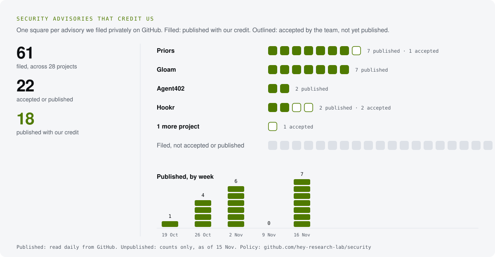
  </picture>
</a>

<b>Published advisories we found (35)</b>

| Project | Advisory | Severity | Our credit |
| --- | --- | --- | --- |
| [Sourcify](https://github.com/argotorg/sourcify) | [GHSA-726m-wjrf-m267](https://github.com/argotorg/sourcify/security/advisories/GHSA-726m-wjrf-m267): two input checks in the public verify endpoint could be combined so that anyone, with no account, made the verification server download a git repository and run a file from it | Critical | Reporter · fixed within about a day |
| [Sourcify](https://github.com/argotorg/sourcify) | [GHSA-w97v-g4q9-998q](https://github.com/argotorg/sourcify/security/advisories/GHSA-w97v-g4q9-998q): a match on an old creation transaction alone stored an Exact Match for an address that now holds different code | Medium | Reporter · fixed within about a day |
| [Sourcify](https://github.com/argotorg/sourcify) | [GHSA-mg7q-xhfh-rmfq](https://github.com/argotorg/sourcify/security/advisories/GHSA-mg7q-xhfh-rmfq): the library call protection left the first 21 bytes of on-chain code unchecked, so a library that starts with other code still got an Exact Match | Medium | Reporter · fixed within about a day |
| [Hookr](https://github.com/Hookr-fun/hookr-contracts) | [GHSA-m3fx-pjvg-cmf7](https://github.com/Hookr-fun/hookr-contracts/security/advisories/GHSA-m3fx-pjvg-cmf7): the per-wallet launch cap counted per contract for router swaps, so one buyer could hold many caps | Low | Reporter |
| [Hookr](https://github.com/Hookr-fun/hookr-contracts) | [GHSA-43mv-935h-rpm7](https://github.com/Hookr-fun/hookr-contracts/security/advisories/GHSA-43mv-935h-rpm7): in the first-release time shares, a lock made after a drop could share in that drop | Low | Finder · fixed in the 29 Oct release |
| [Priors](https://github.com/priors-agents/priors) | [GHSA-98wp-7ghc-6f3w](https://github.com/priors-agents/priors/security/advisories/GHSA-98wp-7ghc-6f3w): with the line board turned on (off by default), `line_send` in @priors/mcp 0.20.0 took a line's amount and premium from the board's answer and never checked the root owner's own signed offer | Medium | Reporter, with another reporter |
| [Priors](https://github.com/priors-agents/priors) | [GHSA-cqcw-9qjc-5qc7](https://github.com/priors-agents/priors/security/advisories/GHSA-cqcw-9qjc-5qc7): in @priors/mcp 0.16.0, the Rialto route sent a quote's transaction data unchecked, so a quote could pay another address or drop the minimum | Medium | Reporter |
| [Priors](https://github.com/priors-agents/priors) | [GHSA-p29w-c8p2-qfm5](https://github.com/priors-agents/priors/security/advisories/GHSA-p29w-c8p2-qfm5): the elizaOS plugin let any room member make the agent pay x402 merchants and open loans | Low | Reporter |
| [Priors](https://github.com/priors-agents/priors) | [GHSA-4w7q-8vph-j5mr](https://github.com/priors-agents/priors/security/advisories/GHSA-4w7q-8vph-j5mr): a PT-USDG price tape resumed after the feed dropped its rounds held credit for about 15 days and seized the whole deposit on default | Low | Reporter |
| [Priors](https://github.com/priors-agents/priors) | [GHSA-jjxq-7r68-44m5](https://github.com/priors-agents/priors/security/advisories/GHSA-jjxq-7r68-44m5): Score v2 kept a market sale made after a plain transfer, carrying the intermediary's income | Low | Reporter |
| [Priors](https://github.com/priors-agents/priors) | [GHSA-qcrq-x8xg-25vg](https://github.com/priors-agents/priors/security/advisories/GHSA-qcrq-x8xg-25vg): the stock vault's `borrowRoom` quoted room the vault and pool refuse | Low | Finder · fixed in Priors' readers, listed as [SV-21](https://github.com/priors-agents/priors/blob/main/docs/SECURITY-v2.md) |
| [Priors](https://github.com/priors-agents/priors) | [GHSA-xccq-5ghg-w7mq](https://github.com/priors-agents/priors/security/advisories/GHSA-xccq-5ghg-w7mq): a V5 borrow over 10 days sent a transaction before it was refused | Low | Finder · fixed in @priors/x402 0.8.3 and @priors/mcp 0.12.1, listed as [P-49](https://github.com/priors-agents/priors/blob/main/docs/SECURITY-v2.md) |
| [Priors](https://github.com/priors-agents/priors) | [GHSA-3vg6-2f3m-j5qm](https://github.com/priors-agents/priors/security/advisories/GHSA-3vg6-2f3m-j5qm): a new PT-USDG price tape started at round 1 once the feed had dropped its old rounds | Low | Finder · fixed on chain, listed as [SV-20](https://github.com/priors-agents/priors/blob/main/docs/SECURITY-v2.md) |
| [Gloam](https://github.com/gloamtrade/gloam) | [GHSA-4whx-32vw-75gp](https://github.com/gloamtrade/gloam/security/advisories/GHSA-4whx-32vw-75gp): in gloam-cashout a payment was tied to its quote only by amount G, so one payer's cash out could redeem another quote | Medium | Reporter · fixed in @gloamtrade/sdk 0.7.1 |
| [Gloam](https://github.com/gloamtrade/gloam) | [GHSA-wxv6-6fjw-c2m9](https://github.com/gloamtrade/gloam/security/advisories/GHSA-wxv6-6fjw-c2m9): paying an ENS name resolved the Ethereum mainnet address for payments on Base, Robinhood Chain and Tempo | Medium | Reporter |
| [Gloam](https://github.com/gloamtrade/gloam) | [GHSA-p2wm-6x89-63c2](https://github.com/gloamtrade/gloam/security/advisories/GHSA-p2wm-6x89-63c2): the SDK and the mppx settle treated a successful outer transaction as a landed sweep | Medium | Reporter |
| [Gloam](https://github.com/gloamtrade/gloam) | [GHSA-5gwv-jpjr-x34r](https://github.com/gloamtrade/gloam/security/advisories/GHSA-5gwv-jpjr-x34r): the free relay's hourly network budget could be used up with payment messages that need no note or proof | Medium | Reporter |
| [Gloam](https://github.com/gloamtrade/gloam) | [GHSA-x8fx-frxx-7f66](https://github.com/gloamtrade/gloam/security/advisories/GHSA-x8fx-frxx-7f66): proofs of funds revealed the prover's later cash-out address and amount | Medium | Reporter |
| [Gloam](https://github.com/gloamtrade/gloam) | [GHSA-fqc9-v45x-jfh8](https://github.com/gloamtrade/gloam/security/advisories/GHSA-fqc9-v45x-jfh8): lower-severity findings: swap escrow liveness, MCP payment handling, recovery | Medium | Reporter |
| [Gloam](https://github.com/gloamtrade/gloam) | [GHSA-vqqr-hg6r-779w](https://github.com/gloamtrade/gloam/security/advisories/GHSA-vqqr-hg6r-779w): the holder vote's ENS lookup let anyone make Gloam's server fetch a URL they chose (CCIP-Read) | Low | Reporter |
| [Gloam](https://github.com/gloamtrade/gloam) | [GHSA-rvhx-3m36-4g8h](https://github.com/gloamtrade/gloam/security/advisories/GHSA-rvhx-3m36-4g8h): in @gloamtrade/sdk 0.0.7 and earlier, an unshield could name the pool itself as recipient | Low | Reporter |
| [NOUNY](https://github.com/nounyagent/nouny-agent) | [GHSA-9j35-fvff-78xp](https://github.com/nounyagent/nouny-agent/security/advisories/GHSA-9j35-fvff-78xp): new AgentVaults could not be created while the stock price feeds paused each weekend | Low | Reporter · fixed within the hour |
| [NOUNY](https://github.com/nounyagent/nouny-agent) | [GHSA-2f3v-w6ff-pm77](https://github.com/nounyagent/nouny-agent/security/advisories/GHSA-2f3v-w6ff-pm77): removed payroll recipients still counted toward the 100-recipient cap, so a payroll could fill up for good | Low | Reporter · fixed within the hour |
| [NOUNY](https://github.com/nounyagent/nouny-agent) | [GHSA-ggxm-63r4-39pp](https://github.com/nounyagent/nouny-agent/security/advisories/GHSA-ggxm-63r4-39pp): NounyHook's one-swap-per-block limit used the L1 block number on Robinhood Chain, not the L2 block | Low | Reporter · fixed within the hour |
| [Purser](https://github.com/PurserAgents/purser) | [GHSA-59mh-vw5p-vr3f](https://github.com/PurserAgents/purser/security/advisories/GHSA-59mh-vw5p-vr3f): one request with no key could put an honest payee on the shared Purser Shield list, so accounts paying it were refused or frozen | Medium | Reporter · fixed the same day |
| [Purser](https://github.com/PurserAgents/purser) | [GHSA-gx7f-32pr-9pmr](https://github.com/PurserAgents/purser/security/advisories/GHSA-gx7f-32pr-9pmr): the firewall's check for takeover calls such as `transferOwnership` never saw the agent's own call on the simulation backend the live node uses | Medium | Reporter · fixed the same day |
| [Purser](https://github.com/PurserAgents/purser) | [GHSA-6gqp-w3qv-9vfv](https://github.com/PurserAgents/purser/security/advisories/GHSA-6gqp-w3qv-9vfv): with models at cost, calls sent at the same time all passed the check before the call, so an account could run up model calls it never paid for | Medium | Reporter · fixed the same day |
| [Purser](https://github.com/PurserAgents/purser) | [GHSA-ch98-775j-jhhv](https://github.com/PurserAgents/purser/security/advisories/GHSA-ch98-775j-jhhv): any contract could pose as a Purser account, and the engine took the module's `Paid` event as proof of payment, so a payment that moved nothing still counted | High | Reporter · fixed within two hours |
| [Purser](https://github.com/PurserAgents/purser) | [GHSA-3h6j-gjj9-vwcm](https://github.com/PurserAgents/purser/security/advisories/GHSA-3h6j-gjj9-vwcm): the engine fetched any URL for an agent key, internal addresses included, and returned the status, headers and body | Medium | Reporter · fixed within two hours |
| [Purser](https://github.com/PurserAgents/purser) | [GHSA-mwgj-gf6x-gm67](https://github.com/PurserAgents/purser/security/advisories/GHSA-mwgj-gf6x-gm67): a caller with no key could use up the relayer's daily gas budget through the x402 facilitator, stopping relayed payments until midnight UTC | Medium | Reporter · fixed within two hours |
| [Agent402](https://github.com/MikeyPetrillo/Agent402) | [GHSA-q7vw-c7hm-m885](https://github.com/MikeyPetrillo/Agent402/security/advisories/GHSA-q7vw-c7hm-m885): the x402 buyer signed the seller's `maxAmountRequired` while its spend caps checked `amount` | High | Reporter · fixed the same day |
| [Agent402](https://github.com/MikeyPetrillo/Agent402) | [GHSA-gcw5-6259-gh72](https://github.com/MikeyPetrillo/Agent402/security/advisories/GHSA-gcw5-6259-gh72): the Stellar settle fallback took any recent transfer from the payer to the treasury as payment | High | Reporter · fixed the same day |
| [x402fi](https://github.com/RWA-ID/x402fi) | [GHSA-2695-fqv4-x6wm](https://github.com/RWA-ID/x402fi/security/advisories/GHSA-2695-fqv4-x6wm): the gateway priced a URL with an encoded `../` as one endpoint (or a free one) and forwarded it to another | High | Reporter · fixed the same day |
| [x402fi](https://github.com/RWA-ID/x402fi) | [GHSA-4mf4-56v3-jvm7](https://github.com/RWA-ID/x402fi/security/advisories/GHSA-4mf4-56v3-jvm7): the public facilitator's `/settle` paid gas for transfers that pay nobody, with no key, floor or budget | Medium | Reporter · fixed the same day |
| [x402fi](https://github.com/RWA-ID/x402fi) | [GHSA-9g6h-3x75-ghv9](https://github.com/RWA-ID/x402fi/security/advisories/GHSA-9g6h-3x75-ghv9): the gateway forwarded paid calls whose payment could not settle, so one balance could back many concurrent calls | Medium | Reporter |

<b>Teams that credited us in their own channels (9)</b>

| Team | What we reported | Credit |
| --- | --- | --- |
| QHooks | a key-storage issue in how the quantum key was protected (Medium); fixed the same day | [security changelog](https://qhooks.com/changelog#quantum-key-protection) |
| Gloam | eight items across the vault contracts, relay, SDK, MCP server and app (Low to Medium) | [joint post on X](https://x.com/HeyResearch/status/2117263881815118077) |
| LoomDesk (loomdesk-sdk) | four gaps in the SDK's send gate (Low) | [0.7.1, commit 2e97226](https://github.com/loomdesk-hq/sdk/commit/2e97226) |
| predict FWA (Sherwood arena) | two game-logic issues, found before launch (Low) | [security review in the README](https://github.com/MirakoolDev/sherwood#security-review-nov-2026) · [post on X](https://x.com/pfwafun/status/2117205853539353009) |
| AgentCity | five findings across the placement market contract, terms page, key custody, ownership docs and checkout, then five smaller notes; each answered in public (not rated) | [their write-up](https://github.com/agentcitylabs/research/blob/main/%5BRnDAC%5D-SecurityReview_HEYResearchLab.md) |
| Stoa | a review they asked for. Two Medium findings, each with a fork test: anyone could block new limit orders with dust, and a finding about which Uniswap V4 pools the router uses. Both fixed on 16 Nov | [Stoa's security review page](https://stoadex.com/docs/security-review) |
| Agraris | public listings could set their own GitHub stars, activity and dates, and links accepted any URL scheme (Low) | [commit 177e360](https://github.com/agrarisai/agraris/commit/177e360) · [post on X](https://x.com/agrarisai/status/2117276441310335355) |
| 1Shot (embedded wallet) | hardening across the open-source embedded wallet: host-replaceable warnings, cross-site extension sessions, requester origins (Low to Medium) | [post on X](https://x.com/1shotapi/status/2121327154864738646) |
| Autonomo (autonomo-sdk) | the Borro borrow path signed every transaction in its answer, outside the agent's spending caps (Medium); fixed and re-tested the same day | [post on X](https://x.com/useautonomo/status/2121624143187812566) |

<!-- NOTPUBLIC:START -->
As of 25 November, 97 more advisories we filed on GitHub are not public yet, and more reports went by email or direct
message. We name none of them until the team has fixed the issue and published it.
<!-- NOTPUBLIC:END -->

Maintain a Robinhood Chain project and want a second pair of eyes? Ask for a review: public code, a pinned commit,
findings sent to you privately first with a test, free for now, and a review, not an audit
([how it works](https://github.com/hey-research-lab/security#ask-for-a-review)). Or turn on
[private vulnerability reporting](https://docs.github.com/en/code-security/how-tos/report-and-fix-vulnerabilities/configure-vulnerability-reporting/configure-for-a-repository)
on your repository, and we report there.

## Fixes we sent upstream

<picture>
  <source media="(prefers-color-scheme: dark)" srcset="assets/fixes-dark.svg">
  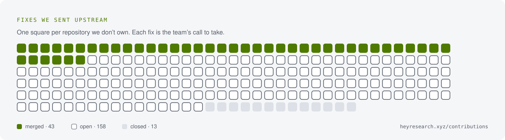
</picture>

<picture>
  <source media="(prefers-color-scheme: dark)" srcset="assets/fixes-timeline-dark.svg">
  
</picture>

<b>The latest fixes merged</b>

<!-- FIXES:START -->
**278 pull requests** sent to **220 repositories** we don’t own, **52 merged** so far. When we read a team’s code to check what they shipped and find a bug we can fix, we send the fix: dead explorer links, wrong chain config, block-time maths, stale contract addresses. Each one is the team’s call to take.

| Merged into | The fix |
| --- | --- |
| [millw14/merrymen](https://github.com/millw14/merrymen/pull/388) | Add the MIT LICENSE file that package.json declares |
| [priors-agents/priors](https://github.com/priors-agents/priors/pull/28) | Drop the OrdoFi RPC (domain gone) and fix the skill's explorer link |
| [ethereum-lists/chains](https://github.com/ethereum-lists/chains/pull/8997) | Remove unresolvable OrdoFi RPC from Robinhood Chain (eip155-4663) |
| [beefyfinance/beefy-api](https://github.com/beefyfinance/beefy-api/pull/1975) | fix(robinhood): drop the OrdoFi RPC, which no longer resolves |
| [0xfnzero/FnzSafe](https://github.com/0xfnzero/FnzSafe/pull/10) | evm-services: replace the unreachable OrdoFi fallback for Robinhood Chain |
| [graphprotocol/networks-registry](https://github.com/graphprotocol/networks-registry/pull/261) | Fix uniqueness check for firehose.firstStreamableBlock.id |
| [Twigpine/openlaunch](https://github.com/Twigpine/openlaunch/pull/109) | fix(math): fmtCompact promotes the suffix when rounding reaches 1000 |
| [1inch/sdks](https://github.com/1inch/sdks/pull/140) | fix(sdk-core): pad HexString.fromBigInt to whole bytes |
| [RevokeCash/revoke.cash](https://github.com/RevokeCash/revoke.cash/pull/311) | fix: keep multicall3 in exploit stats for genesis predeploys |
| [0xfnzero/FnzSafe](https://github.com/0xfnzero/FnzSafe/pull/9) | extension: skip discovered tokens whose decimals are null instead of reading them as 0 |
| [0xfnzero/FnzSafe](https://github.com/0xfnzero/FnzSafe/pull/7) | evm-services: fix Robinhood Chain explorer URL (robinscan.io does not resolve) |
| [1Shot-API/embedded-wallet](https://github.com/1Shot-API/embedded-wallet/pull/154) | Fix the Ethereum BTC/USD and PAXG/USD addresses in the trusted Chainlink feed list |

Every fix, open, merged or closed: **[heyresearch.xyz/contributions](https://heyresearch.xyz/contributions)** · refreshed daily
<!-- FIXES:END -->

<!-- LISTED:START -->
**Where HEY is listed:** [punkpeye/awesome-remote-mcp-servers](https://github.com/punkpeye/awesome-remote-mcp-servers/pull/1769) · [AIAnytime/Awesome-MCP-Servers](https://github.com/AIAnytime/Awesome-MCP-Servers/pull/330) · [marcelscruz/public-apis](https://github.com/marcelscruz/public-apis/pull/1520) · [mcpHQ/awesome-mcp-servers](https://github.com/mcpHQ/awesome-mcp-servers/pull/423) · [davepoon/buildwithclaude](https://github.com/davepoon/buildwithclaude/pull/563) · [collabnix/awesome-mcp-lists](https://github.com/collabnix/awesome-mcp-lists/pull/272) · [ahmet/awesome-web3](https://github.com/ahmet/awesome-web3/pull/863) · [awesomedata/apd-core](https://github.com/awesomedata/apd-core/pull/955) · [public-apis/public-apis](https://github.com/public-apis/public-apis/pull/8411) · [punkpeye/awesome-mcp-servers](https://github.com/punkpeye/awesome-mcp-servers/pull/16368). These are pull requests that add HEY to someone else's list or directory, so they are not counted as fixes.
<!-- LISTED:END -->

<b>Fixes teams shipped in their own commits</b>

Some teams take a fix into their own commit instead of merging ours. These count the same to us:

| Shipped by | What landed |
| --- | --- |
| [Gloam](https://github.com/gloamtrade/gloam/pull/124) | all six fixes from [#117](https://github.com/gloamtrade/gloam/pull/117) to [#122](https://github.com/gloamtrade/gloam/pull/122): MCP version pins, cash-out address guard, payment settlement, API key rename, MCP spend limits, access-key generation |
| [HoodFi](https://github.com/RWA-ID/hoodfi-eth) | [#12](https://github.com/RWA-ID/hoodfi-eth/pull/12), [#13](https://github.com/RWA-ID/hoodfi-eth/pull/13) and [#14](https://github.com/RWA-ID/hoodfi-eth/pull/14) merged with our commits in #17, #19 and #20; [#15](https://github.com/RWA-ID/hoodfi-eth/pull/15) shipped as a narrower fix in #18 |

Merged one of our fixes and liked it? A shout-out on X helps a small team keep sending them: tag
[x.com/HeyResearch](https://x.com/HeyResearch) and say what we fixed. That's the only thank-you we ask for.

## Built on HEY

Products that read HEY's builder record and name themselves on their calls:

<!-- BUILTWITH:START -->
| Product | Using HEY since | On HEY |
| --- | --- | --- |
| [Bucks (undertow)](https://www.undertow.agency) | 2026-11-04 or earlier | [its page](https://heyresearch.xyz/project/cleared) |
| [Factor](https://factoragents.fun) | 2026-11-08 or earlier | [its page](https://heyresearch.xyz/project/factor) |
| [Loudscene](https://www.loudscene.com) | 2026-11-04 or earlier | [its page](https://heyresearch.xyz/project/loudscene) |
| [OakAgentKit](https://oakagentkit.org) | 2026-10-29 or earlier | [its page](https://heyresearch.xyz/project/oakagentkit) |
| [OddsEngine](https://oddsengine.live) | 2026-11-08 or earlier | [its page](https://heyresearch.xyz/project/oddsengine) |
| [Ostra](https://ostraagent.xyz) | 2026-11-05 or earlier | [its page](https://heyresearch.xyz/project/ostra-agent) |
| [predict FWA](https://www.pfwa.fun) | 2026-10-22 or earlier | [its page](https://heyresearch.xyz/project/predict-fwa) |
| [Quotum](https://quotum.org) | 2026-11-04 or earlier | [its page](https://heyresearch.xyz/project/quotum) |
| [Reinkeep](https://reinkeep.xyz) | 2026-11-23 or earlier | no page |
| [Toll](https://t0ll.xyz) | 2026-11-08 or earlier | [its page](https://heyresearch.xyz/project/toll) |
| [Trnch](https://trnch.fun) | 2026-11-10 or earlier | [its page](https://heyresearch.xyz/project/trnch) |
| [Wafermap](https://wafermap.xyz) | 2026-11-06 or earlier | [its page](https://heyresearch.xyz/project/wafermap) |

As listed on **[heyresearch.xyz/developers/built-with](https://heyresearch.xyz/developers/built-with)**, A to Z, a credit and never a ranking. "Using HEY since" is the oldest call HEY's request log still holds (it keeps 90 days) · refreshed daily
<!-- BUILTWITH:END -->

<b>Teams that show HEY's record, and protocols whose facts HEY reads</b>

What each does with HEY, A to Z:

| Project | What it does with HEY |
| --- | --- |
| [Axon](https://x.com/axon402) | shows its live HEY badge on its own site |
| [Chit](https://x.com/usechit) | Chit's bot shows HEY's builder card for a token, where people trade |
| [GRIFT](https://x.com/Griftwrld) | its World Studio grant judges builders with HEY's public builder record as the evidence; GRIFT decides and pays |
| [HoodLock](https://x.com/HoodLockRH) | HEY reads HoodLock's locks on chain and shows each on the token's page, credited to HoodLock in its Token Passport |
| [HoodRugCheck](https://hoodrugcheck.com) | shows a Team check from HEY right next to its own contract score, kept as a separate box |
| [Insula World](https://x.com/insulaworld) | its agent sent the first request to HEY's ERC-8004 validator, which answered on chain from the counted ships |
| [Orus](https://x.com/Orus_agent) | Orus's trading agents can use HEY's builder evidence as an optional entry filter |
| [PFWA](https://x.com/pfwafun) | shows HEY's builder card on every Robinhood Chain token market, our badge in its footer and HEY in its "Powered by" strip |
| [Quotum](https://x.com/quotumorg) | rh-preflight, a Hermes agent plugin, reads HEY's builder record before an agent touches a Robinhood Chain address |
| [RHTools](https://x.com/RHToolsXYZ) | RHTools draws the chart, HEY answers who built the token; each links to the other |
| [Torch](https://x.com/Torchpaddotfun) | HEY reads Torch's launch factory, so every Torch builder's launch and building record show on HEY, credited to Torch |
| [Trnch](https://x.com/trnchfun) | puts a Team box from HEY on every token page: one check for the token, one for the team behind it |

<picture>
  <source media="(prefers-color-scheme: dark)" srcset="assets/launchpads-dark.svg">
  
</picture>

Every token is credited to the launchpad that made it, in its [Token Passport](https://heyresearch.xyz/passport). Want builder context in your product? The API, the embed and the badge are free:
[heyresearch.xyz/developers/partners](https://heyresearch.xyz/developers/partners). Running a protocol on Robinhood Chain
with public on-chain data or a public API? Ask to join the [Token Passport](https://heyresearch.xyz/passport).

## Use it

| | |
| --- | --- |
| **Check a token** | [heyresearch.xyz](https://heyresearch.xyz) · `npx @hey-research-lab/check '$TICKER'` · [Telegram bot](https://t.me/HeyResearch_Bot) |
| **API** | free, no key: `GET /api/v1/builder?chain=4663&token=0x…` · [docs](https://heyresearch.xyz/developers) |
| **Agents (MCP)** | `heyresearch.xyz/mcp`, no key, stdio or HTTP · skills and plugins for Claude Code, AgentKit, GOAT, Virtuals and ElizaOS: [developers/agents](https://heyresearch.xyz/developers/agents) |
| **ERC-8004** | agent #8783 on Robinhood Chain (#56081 Ethereum, #1148006 Base), and a validator that answers one claim from counted ships: [how to ask](https://heyresearch.xyz/developers/agents#validate) |
| **Proof of Ship** | an escrow that pays a builder only when HEY signs that it counted real ships: [Robinhood Chain ($WIF)](https://github.com/hey-research-lab/proof-of-ship) · [NEAR (USDC)](https://github.com/hey-research-lab/proof-of-ship-near) |
| **For builders** | your page, a live [badge](https://heyresearch.xyz/badges), fixes sent as pull requests, security notes sent privately. None of it buys a place: what you ship decides |
| **Open data** | daily snapshots, CC BY 4.0, no price or holder field: [heyresearch.xyz/data](https://heyresearch.xyz/data) · [Hugging Face](https://huggingface.co/datasets/heyresearch/robinhood-chain-builders) |

The hosted MCP server is listed as a community connector in [Claude's Connectors Directory](https://claude.ai/directory/hey-research-lab).
<!-- MCP:START -->
It is also listed in the [Official MCP Registry](https://registry.modelcontextprotocol.io/v0/servers/io.github.hey-research-lab%2Fhey-research/versions/latest) as `io.github.hey-research-lab/hey-research`, version 0.3.5, and on [mcptry](https://mcptry.com/servers/io.github.hey-research-lab/hey-research).
<!-- MCP:END -->

<!-- HOOKS:START -->
Of the **33,072 hook contracts** HEY has seen in Robinhood Chain's Uniswap v4 pools, **162** are tied to **76 published projects**, each with the evidence that ties it: on chain, an address linked to the project, the project's factory, or HEY's review. **[heyresearch.xyz/integrations/uniswap/hooks](https://heyresearch.xyz/integrations/uniswap/hooks)** · refreshed daily
<!-- HOOKS:END -->

## Open source

<b>Our public repositories</b>

| Repository | What it is |
| --- | --- |
| [awesome-robinhood-chain](https://github.com/hey-research-lab/awesome-robinhood-chain) | Projects building on Robinhood Chain, regenerated weekly from the open dataset |
| [hey-check](https://github.com/hey-research-lab/hey-check) | Dev check for any Robinhood Chain token: is anyone building it? A terminal answer and a shareable card |
| [chainprint](https://github.com/hey-research-lab/chainprint) | Offline scan of a source tree for evidence that the code targets Robinhood Chain, with a confidence anyone can recompute |
| [rhchain-registry](https://github.com/hey-research-lab/rhchain-registry) | A CI-validated registry of Robinhood Chain infrastructure, a public source for every entry |
| [hey-cli](https://github.com/hey-research-lab/hey-cli) | HEY's research from the terminal |
| [hey-ship-action](https://github.com/hey-research-lab/hey-ship-action) | A GitHub Action that writes evidence linking a commit or release to a Robinhood Chain deployment |
| [hey-agent-skills](https://github.com/hey-research-lab/hey-agent-skills) | An Agent Skill and Claude Code plugin for builder research |
| [hey-agentkit](https://github.com/hey-research-lab/hey-agentkit) · [hey-goat-plugin](https://github.com/hey-research-lab/hey-goat-plugin) · [hey-virtuals-plugin](https://github.com/hey-research-lab/hey-virtuals-plugin) · [plugin-hey-research](https://github.com/hey-research-lab/plugin-hey-research) | HEY's builder research as tools for Coinbase AgentKit, GOAT, Virtuals GAME and ElizaOS agents, each on npm |
| [robinhood-chain-starter](https://github.com/hey-research-lab/robinhood-chain-starter) | A Foundry and viem starter for Robinhood Chain (4663): a contract, tests, deploy and Multicall3 read scripts |
| [hey-data](https://github.com/hey-research-lab/hey-data) | Research snapshots of HEY's public builder records as NDJSON, the hooks file and the Hugging Face copy |
| [proof-of-ship](https://github.com/hey-research-lab/proof-of-ship) | A $WIF bounty escrow on Robinhood Chain that pays a builder when HEY signs that it counted real ships |
| [proof-of-ship-near](https://github.com/hey-research-lab/proof-of-ship-near) | The same escrow on NEAR, in USDC, verifying HEY's signature on chain with `ecrecover` |
| [hey-research-open](https://github.com/hey-research-lab/hey-research-open) | The open part of the platform: SDK, MCP server, scoring and source adapters |
| [hey-embed](https://github.com/hey-research-lab/hey-embed) | A dependency-free `<hey-project>` web component, with a React wrapper, to embed a project's builder evidence |
| [hey-telegram-bot](https://github.com/hey-research-lab/hey-telegram-bot) | A self-hostable, read-only Telegram bot for HEY lookups, powered only by the public API |
| [hey-agent-contract](https://github.com/hey-research-lab/hey-agent-contract) | The public contract of HEY's agent answers: schemas, types, fixtures and test vectors |
| [hey-project-manifest](https://github.com/hey-research-lab/hey-project-manifest) | `/.well-known/hey-project.json`, a format for a project to declare its repos, contracts and sites |
| [hey-research-receipts](https://github.com/hey-research-lab/hey-research-receipts) | A spec and validator for what an agent cited and concluded about a project |
| [security](https://github.com/hey-research-lab/security) | How we report security issues to Robinhood Chain projects, and the teams that fixed them |
| [hey-edge-probe](https://github.com/hey-research-lab/hey-edge-probe) | An hourly outside check of heyresearch.xyz against our own performance budget |

Every public repository, including data snapshots, embeds and agent-framework plugins:
[github.com/hey-research-lab](https://github.com/hey-research-lab?tab=repositories&type=source).
Small, well-described issues are labelled
[good first issue](https://github.com/search?q=user%3Ahey-research-lab+label%3A%22good+first+issue%22+state%3Aopen&type=issues).
Found a security issue in one of our repositories? Write to hi@heyresearch.xyz or [x.com/HeyResearch](https://x.com/HeyResearch).

Community-run by HEY Research Lab · not affiliated with or endorsed by Robinhood, Base, Uniswap Labs, Hugging Face, NEAR or any other project named here · a HEY badge is verified from
public evidence, not a Robinhood certification · not investment advice.

