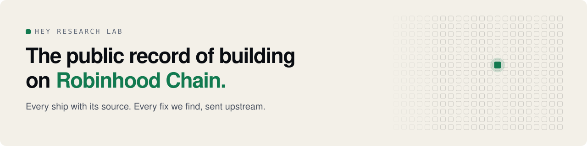
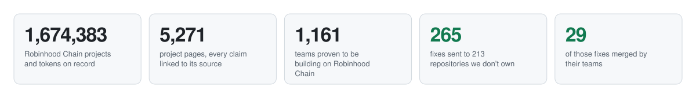

<a href="https://heyresearch.xyz">
  <picture>
    <source media="(prefers-color-scheme: dark)" srcset="assets/banner-dark.svg">
    
  </picture>
</a>

  
  
  
  
  

Robinhood Chain has more than a million token contracts. We can prove about a thousand teams are building on it.
**Hey Research Lab** reads their code, releases and contract deployments and answers one question with evidence:
**who is still building, and what did they ship?** Every claim links to its source. Price is context, never the verdict.
Browsing needs no wallet, and nothing on HEY is for sale.

<picture>
  <source media="(prefers-color-scheme: dark)" srcset="assets/stats-dark.svg">
  
</picture>

## 🧱 For builders

Building on Robinhood Chain? Everything here is free, and none of it buys a place: what you ship decides.

| | |
| --- | --- |
| **A page that shows your work** | every release, deployment and code week we read, each linked to its source: find yours on [heyresearch.xyz](https://heyresearch.xyz) or [submit it](https://heyresearch.xyz/submit) |
| **Fixes, not just findings** | we read your public code; when we find a bug we can fix, we send a pull request, and anything security-related goes to you privately first |
| **A live badge** | your HEY badge for your site or README, updated from public evidence: [heyresearch.xyz/badges](https://heyresearch.xyz/badges) |
| **Funding for shipping** | backers can fund you in $WIF through [Proof of Ship](https://github.com/hey-research-lab/proof-of-ship), an escrow that pays only when HEY counts real ships |
| **Your data, open** | the API, the embed and the open dataset are free for your own product: [heyresearch.xyz/developers](https://heyresearch.xyz/developers) |

## 🛠️ Fixes we sent upstream

<!-- FIXES:START -->
**255 pull requests** sent to **212 repositories** we don’t own, **28 merged** so far. When we read a team’s code to check what they shipped and find a bug we can fix, we send the fix: dead explorer links, wrong chain config, block-time maths, stale contract addresses. Each one is the team’s call to take.

| Merged into | The fix |
| --- | --- |
| [pgen0x/azimuth](https://github.com/pgen0x/azimuth/pull/249) | test(scanner): look up true and false on PATH in the entry-routing test |
| [mcpHQ/awesome-mcp-servers](https://github.com/mcpHQ/awesome-mcp-servers/pull/423) | Add HEY Research Lab |
| [agentsea/nautilo](https://github.com/agentsea/nautilo/pull/136) | fix(sheets): read date-only strings as local calendar dates |
| [covenantx402/covenant](https://github.com/covenantx402/covenant/pull/8) | fix(chains): point Robinhood Chain's explorer at Blockscout |
| [covenantx402/covenant](https://github.com/covenantx402/covenant/pull/7) | fix(kit): use the token's own EIP-712 domain for USDG and Base Sepolia USDC |
| [marcelscruz/public-apis](https://github.com/marcelscruz/public-apis/pull/1520) | Add HEY Research Lab API |
| [AIAnytime/Awesome-MCP-Servers](https://github.com/AIAnytime/Awesome-MCP-Servers/pull/330) | Add HEY Research Lab |
| [vfat-io/vfat-tools](https://github.com/vfat-io/vfat-tools/pull/2481) | Keep Robinhood Morpho and Equilibra log reads within the RPC block limit |
| [vfat-io/vfat-tools](https://github.com/vfat-io/vfat-tools/pull/2492) | TETRAVAULT: read a wallet's bond vesting from its positions |
| [1xGiraffe/hydration-neckwork](https://github.com/1xGiraffe/hydration-neckwork/pull/8) | fix(mcp): bound tool input size and bump the MCP SDK to 1.32 (GHSA-46jr-4wx8-v453) |
| [DefiLlama/dimension-adapters](https://github.com/DefiLlama/dimension-adapters/pull/10386) | catnip: count the 1/3 protocol fee the pairs mint to the NIP maker |
| [cryptoduke01/gloam](https://github.com/cryptoduke01/gloam/pull/6) | Point the issue chooser at SECURITY.md for vulnerability reports |

Every fix, open, merged or closed: **[heyresearch.xyz/contributions](https://heyresearch.xyz/contributions)** · refreshed daily
<!-- FIXES:END -->

**Merged one of our fixes and liked it?** A shout-out on X helps a small team keep sending them: tag
[x.com/HeyResearch](https://x.com/HeyResearch) and say what we fixed. That's the only thank-you we ask for.

## 🛡️ Security credits

When we find something that could put funds at risk, it goes to the team privately first, through their own channel.
We publish nothing until they do.

| Project | Advisory | Severity | Our credit |
| --- | --- | --- | --- |
| [Priors](https://github.com/priors-agents/priors) | [GHSA-3vg6-2f3m-j5qm](https://github.com/priors-agents/priors/security/advisories/GHSA-3vg6-2f3m-j5qm): a new PT-USDG price tape started at round 1 once the feed had dropped its old rounds | Low | Finder · fixed on chain, listed as [SV-20](https://github.com/priors-agents/priors/blob/main/docs/SECURITY-v2.md) |

Maintain a Robinhood Chain project and want a second pair of eyes? Turn on
[private vulnerability reporting](https://docs.github.com/en/code-security/security-advisories/working-with-repository-security-advisories/configuring-private-vulnerability-reporting-for-a-repository)
on your repository, and we report there.

## 🔎 Use it

| | |
| --- | --- |
| **Check any token or project** | [heyresearch.xyz](https://heyresearch.xyz) · from a terminal: `npx @hey-research-lab/check '$TICKER'` |
| **Weekly builder report** | who shipped on Robinhood Chain this week, each ship with its source: [heyresearch.xyz/updates](https://heyresearch.xyz/updates) |
| **Public API** | one call per token: `GET /api/v1/builder?chain=4663&token=0x…` · [docs](https://heyresearch.xyz/developers) · [changelog](https://heyresearch.xyz/developers/changelog) |
| **Embed** | a live builder card on any site: `<hey-project contract="0x…">` · [embeds](https://heyresearch.xyz/developers) |
| **Token Passport** | a token's page credits the Robinhood Chain protocols whose facts HEY reads (a HoodLock lock, the launchpad that minted it, its Uniswap v4 hooks), each with a link: [heyresearch.xyz/passport](https://heyresearch.xyz/passport) |
| **Badge** | a project's live HEY badge for its site or README; projects showing one are thanked on [heyresearch.xyz/badges](https://heyresearch.xyz/badges) |
| **Open data** | daily snapshots, CC BY 4.0: [heyresearch.xyz/data](https://heyresearch.xyz/data) |

## 🤖 For AI agents

- **Hosted MCP server:** `https://heyresearch.xyz/mcp`, no key. Listed as a community connector in
  [Claude's Connectors Directory](https://claude.ai/directory/hey-research-lab).
- **On chain:** HEY is registered as an ERC-8004 agent on Robinhood Chain (agent #8783), with an A2A card at
  [`/.well-known/agent-card.json`](https://heyresearch.xyz/.well-known/agent-card.json).
- **Skills and plugins:** [hey-agent-skills](https://github.com/hey-research-lab/hey-agent-skills) (an Agent Skill and Claude Code plugin).

## 🤝 Working with

| Project | How |
| --- | --- |
| [Chit](https://x.com/usechit) | Chit's bot shows HEY's builder card for a token, where people trade |
| [RHTools](https://x.com/RHToolsXYZ) | RHTools draws the chart, HEY answers who built the token; each links to the other |
| [HoodLock](https://x.com/HoodLockRH) | HEY reads HoodLock's locks on chain and shows each on the token's page |
| [Orus](https://x.com/Orus_agent) | Orus's trading agents can use HEY's builder evidence as an optional entry filter |
| [Axon](https://x.com/axon402) | shows its live HEY badge on its own site |
| [PFWA](https://x.com/pfwafun) | shows HEY's builder card on every Robinhood Chain token market, our badge in its footer and HEY in its "Powered by" strip |

Building on Robinhood Chain and want builder context in your product? The API, the embed and the badge are free:
[heyresearch.xyz/developers/partners](https://heyresearch.xyz/developers/partners). Running a protocol on Robinhood Chain with
public on-chain data or a public API? Ask to join the [Token Passport](https://heyresearch.xyz/passport); nobody pays for a stamp.

## 📦 Open source

| Repository | What it is |
| --- | --- |
| [awesome-robinhood-chain](https://github.com/hey-research-lab/awesome-robinhood-chain) | Projects building on Robinhood Chain, regenerated weekly from the open dataset |
| [hey-check](https://github.com/hey-research-lab/hey-check) | Dev check for any Robinhood Chain token: is anyone building it? A terminal answer and a shareable card |
| [chainprint](https://github.com/hey-research-lab/chainprint) | Offline scan of a source tree for evidence that the code targets Robinhood Chain, with a confidence anyone can recompute |
| [rhchain-registry](https://github.com/hey-research-lab/rhchain-registry) | A CI-validated registry of Robinhood Chain infrastructure, a public source for every entry |
| [hey-cli](https://github.com/hey-research-lab/hey-cli) | HEY's research from the terminal |
| [hey-ship-action](https://github.com/hey-research-lab/hey-ship-action) | A GitHub Action that writes evidence linking a commit or release to a Robinhood Chain deployment |
| [hey-agent-skills](https://github.com/hey-research-lab/hey-agent-skills) | An Agent Skill and Claude Code plugin for builder research |
| [hey-research-open](https://github.com/hey-research-lab/hey-research-open) | The open part of the platform: SDK, MCP server, scoring and source adapters |

Every public repository, including data snapshots, embeds and agent-framework plugins:
[github.com/hey-research-lab](https://github.com/hey-research-lab?tab=repositories&type=source).

**Contribute:** small, well-described issues are labelled
[good first issue](https://github.com/search?q=user%3Ahey-research-lab+label%3A%22good+first+issue%22+state%3Aopen&type=issues).
Found a security issue in one of our repositories? Write to hi@heyresearch.xyz or [x.com/HeyResearch](https://x.com/HeyResearch).

Community-run by Hey Research Lab · not affiliated with or endorsed by Robinhood · a HEY badge is verified from
public evidence, not a Robinhood certification · not investment advice.
