<a href="https://heyresearch.xyz">
  <picture>
    <source media="(prefers-color-scheme: dark)" srcset="assets/banner-dark.svg">
    
  </picture>
</a>

  <a href="https://heyresearch.xyz">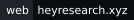</a>
  
  <a href="https://heyresearch.xyz/mcp">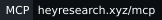</a>
  <a href="https://www.npmjs.com/package/@hey-research-lab/sdk">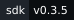</a>
  <a href="https://heyresearch.xyz/data">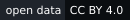</a>

  <b>Reads</b> the code, releases and deployments of teams building on Robinhood Chain, and now Base. 
  <b>Answers</b> one question with evidence: who is still building, and what did they ship? 
  <b>Links</b> every claim to its source. Price is context, never the verdict. Free, no wallet, nothing for sale.

  <a href="#robinhood-chain-live">The chain, live</a> ·
  <a href="#now-on-base">Now on Base</a> ·
  <a href="#launchpads">Launchpads</a> ·
  <a href="#built-on-hey">Built on HEY</a> ·
  <a href="#agents-checking-agents">Agents checking agents</a> ·
  <a href="#proof-of-ship">Proof of Ship</a> ·
  <a href="#for-builders">For builders</a> ·
  <a href="#fixes-we-sent-upstream">Fixes upstream</a> ·
  <a href="#security-credits">Security credits</a> ·
  <a href="#use-it">Use it</a> ·
  <a href="#open-source">Open source</a>

<picture>
  <source media="(prefers-color-scheme: dark)" srcset="assets/stats-dark.svg">
  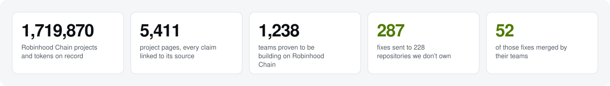
</picture>

## Robinhood Chain, live

<picture>
  <source media="(prefers-color-scheme: dark)" srcset="assets/chain-dark.svg">
  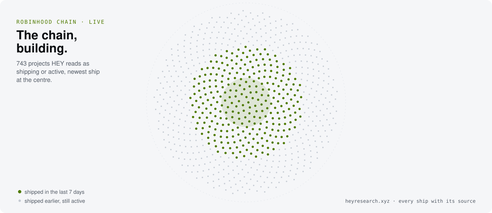
</picture>

<picture>
  <source media="(prefers-color-scheme: dark)" srcset="assets/launches-dark.svg">
  
</picture>

<picture>
  <source media="(prefers-color-scheme: dark)" srcset="assets/ships-dark.svg">
  
</picture>

Redrawn every day from [heyresearch.xyz](https://heyresearch.xyz)'s public API. Browsing HEY needs no wallet, and nothing on it is for sale.

## Now on Base

Robinhood Chain is home. Base is the first chain HEY has added (12 Nov), and a chain switcher sits in the top bar of every
page on [heyresearch.xyz](https://heyresearch.xyz).

**[heyresearch.xyz/base](https://heyresearch.xyz/base)** lists **63 Base builders**, each checked by hand: a contract of
its own on Base, a ship in the last four weeks, and the source for both.
Each one has its own page at `heyresearch.xyz/base/<slug>`. The list is refreshed every week, and daily tracking comes
next.

## Launchpads

<picture>
  <source media="(prefers-color-scheme: dark)" srcset="assets/launchpads-dark.svg">
  
</picture>

HEY reads launches from the chain's launch factories and credits every token to the launchpad that made it, with a
Launched stamp in its [Token Passport](https://heyresearch.xyz/passport). The same rules hold for every launchpad, and
nobody pays for a stamp.

| Launchpad | What HEY reads |
| --- | --- |
| [FOBO](https://fobo.fun) | its launch factory, read on chain: more than 1,200 FOBO launches so far, each marked "Launched via FOBO" |
| [Pons](https://ponsfamily.com) | each launch record, and the day a launch graduates into a Uniswap v4 pool, with its receipt |
| [Torch](https://torchpad.fun) | the launch factory the Torch team sent us: more than 2,100 Torch launches so far, each marked "Launched via Torch" |

Run a launchpad on Robinhood Chain? Send us your factory: [heyresearch.xyz/passport](https://heyresearch.xyz/passport).

## Built on HEY

Products that put HEY's builder record in front of their own users, and protocols whose facts HEY reads, A to Z:

| Project | What it does with HEY |
| --- | --- |
| [Axon](https://x.com/axon402) | shows its live HEY badge on its own site |
| [Chit](https://x.com/usechit) | Chit's bot shows HEY's builder card for a token, where people trade |
| [HoodLock](https://x.com/HoodLockRH) | HEY reads HoodLock's locks on chain and shows each on the token's page, credited to HoodLock in its Token Passport |
| [HoodRugCheck](https://hoodrugcheck.com) | shows a Team check from HEY right next to its own contract score, kept as a separate box |
| [Insula World](https://x.com/insulaworld) | its agent sent the first request to HEY's ERC-8004 validator, which answered on chain from the counted ships |
| [Orus](https://x.com/Orus_agent) | Orus's trading agents can use HEY's builder evidence as an optional entry filter |
| [PFWA](https://x.com/pfwafun) | shows HEY's builder card on every Robinhood Chain token market, our badge in its footer and HEY in its "Powered by" strip |
| [Quotum](https://x.com/quotumorg) | rh-preflight, a Hermes agent plugin, reads HEY's builder record before an agent touches a Robinhood Chain address |
| [RHTools](https://x.com/RHToolsXYZ) | RHTools draws the chart, HEY answers who built the token; each links to the other |
| [Trnch](https://x.com/trnchfun) | puts a Team box from HEY on every token page: one check for the token, one for the team behind it |

Want builder context in your product? The API, the embed and the badge are free:
[heyresearch.xyz/developers/partners](https://heyresearch.xyz/developers/partners). Running a protocol on Robinhood Chain
with public on-chain data or a public API? Ask to join the [Token Passport](https://heyresearch.xyz/passport).

## Agents checking agents

<picture>
  <source media="(prefers-color-scheme: dark)" srcset="assets/validator-dark.svg">
  
</picture>

HEY is an ERC-8004 agent: **#8783** on Robinhood Chain, **#56081** on Ethereum and **#1148006** on Base. It is also an
ERC-8004 validator on Robinhood Chain and Base for one claim: that a project HEY publishes shipped between two times. It
answers only from its counted ships, only for an agent tied to the project, and a response endorses nothing.
[Insula World](https://x.com/insulaworld)'s agent sent the first request, and HEY answered it on chain. How to ask:
[heyresearch.xyz/developers/agents](https://heyresearch.xyz/developers/agents#validate).

<picture>
  <source media="(prefers-color-scheme: dark)" srcset="assets/agent-dark.svg">
  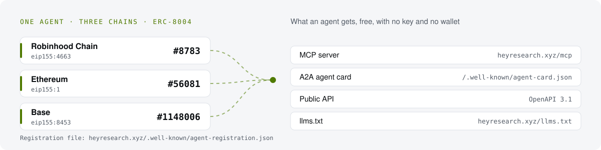
</picture>

<picture>
  <source media="(prefers-color-scheme: dark)" srcset="assets/agents-dark.svg">
  
</picture>

Registrations, feedback and validations are counted live, with their definitions:
[heyresearch.xyz/developers/agents/stats](https://heyresearch.xyz/developers/agents/stats).

The hosted MCP server is listed as a community connector in [Claude's Connectors Directory](https://claude.ai/directory/hey-research-lab).
<!-- MCP:START -->
It is also listed in the [Official MCP Registry](https://registry.modelcontextprotocol.io/v0/servers/io.github.hey-research-lab%2Fhey-research/versions/latest) as `io.github.hey-research-lab/hey-research`, version 0.3.5, and on [mcptry](https://mcptry.com/servers/io.github.hey-research-lab/hey-research).
<!-- MCP:END -->

Skills and plugins: [hey-agent-skills](https://github.com/hey-research-lab/hey-agent-skills), an Agent Skill and Claude Code plugin,
and plugins on npm for [Coinbase AgentKit](https://github.com/hey-research-lab/hey-agentkit) (`@hey-research-lab/agentkit`),
[GOAT](https://github.com/hey-research-lab/hey-goat-plugin) (`@hey-research-lab/goat-plugin`),
[Virtuals GAME](https://github.com/hey-research-lab/hey-virtuals-plugin) (`@hey-research-lab/virtuals-plugin`) and
[ElizaOS](https://github.com/hey-research-lab/plugin-hey-research) (`@hey-research-lab/plugin-hey-research`).

## Proof of Ship

An open-source escrow that pays a builder only when HEY signs that it counted real ships. Backers fund a bounty, the
contract checks HEY's signature, and HEY holds, moves and earns nothing in it.

| Escrow | Where it pays |
| --- | --- |
| [proof-of-ship](https://github.com/hey-research-lab/proof-of-ship) | on Robinhood Chain, bounties in $WIF; the first bounty paid out to [predict FWA](https://x.com/pfwafun) |
| [proof-of-ship-near](https://github.com/hey-research-lab/proof-of-ship-near) | on NEAR, bounties in USDC (`escrow.heyresearch.near`), verifying HEY's signature on chain with `ecrecover` |

## For builders

Building on Robinhood Chain? Everything here is free, and none of it buys a place: what you ship decides.

| | |
| --- | --- |
| **A page that shows your work** | every release, deployment and code week we read, each linked to its source: find yours on [heyresearch.xyz](https://heyresearch.xyz) or [submit it](https://heyresearch.xyz/submit) |
| **Fixes, not just findings** | we read your public code; when we find a bug we can fix, we send a pull request, and anything security-related goes to you privately first |
| **A live badge** | your HEY badge for your site or README, updated from public evidence: [heyresearch.xyz/badges](https://heyresearch.xyz/badges) |
| **Funding for shipping** | backers can fund you through [Proof of Ship](#proof-of-ship), an escrow that pays only when HEY signs that it counted real ships |
| **Your data, open** | the API, the embed and the open dataset are free for your own product: [heyresearch.xyz/developers](https://heyresearch.xyz/developers) |
| **Counted in Electric Capital's developer data** | we added Robinhood Chain to [Open Dev Data](https://github.com/electric-capital/open-dev-data/pull/3115) as its own ecosystem (1,183 repositories) and send it a monthly update, so builders here show up in the industry's developer numbers |

## Fixes we sent upstream

<picture>
  <source media="(prefers-color-scheme: dark)" srcset="assets/fixes-dark.svg">
  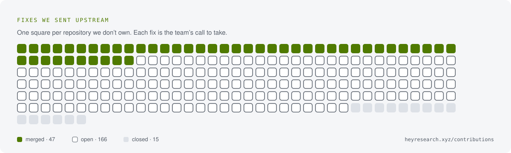
</picture>

<picture>
  <source media="(prefers-color-scheme: dark)" srcset="assets/fixes-timeline-dark.svg">
  
</picture>

<b>The latest fixes merged</b>

<!-- FIXES:START -->
**272 pull requests** sent to **214 repositories** we don’t own, **51 merged** so far. When we read a team’s code to check what they shipped and find a bug we can fix, we send the fix: dead explorer links, wrong chain config, block-time maths, stale contract addresses. Each one is the team’s call to take.

| Merged into | The fix |
| --- | --- |
| [ethereum-lists/chains](https://github.com/ethereum-lists/chains/pull/8997) | Remove unresolvable OrdoFi RPC from Robinhood Chain (eip155-4663) |
| [beefyfinance/beefy-api](https://github.com/beefyfinance/beefy-api/pull/1975) | fix(robinhood): drop the OrdoFi RPC, which no longer resolves |
| [0xfnzero/FnzSafe](https://github.com/0xfnzero/FnzSafe/pull/10) | evm-services: replace the unreachable OrdoFi fallback for Robinhood Chain |
| [graphprotocol/networks-registry](https://github.com/graphprotocol/networks-registry/pull/261) | Fix uniqueness check for firehose.firstStreamableBlock.id |
| [Twigpine/openlaunch](https://github.com/Twigpine/openlaunch/pull/109) | fix(math): fmtCompact promotes the suffix when rounding reaches 1000 |
| [1inch/sdks](https://github.com/1inch/sdks/pull/140) | fix(sdk-core): pad HexString.fromBigInt to whole bytes |
| [RevokeCash/revoke.cash](https://github.com/RevokeCash/revoke.cash/pull/311) | fix: keep multicall3 in exploit stats for genesis predeploys |
| [0xfnzero/FnzSafe](https://github.com/0xfnzero/FnzSafe/pull/9) | extension: skip discovered tokens whose decimals are null instead of reading them as 0 |
| [0xfnzero/FnzSafe](https://github.com/0xfnzero/FnzSafe/pull/7) | evm-services: fix Robinhood Chain explorer URL (robinscan.io does not resolve) |
| [1Shot-API/embedded-wallet](https://github.com/1Shot-API/embedded-wallet/pull/154) | Fix the Ethereum BTC/USD and PAXG/USD addresses in the trusted Chainlink feed list |
| [DefiLlama/chainlist](https://github.com/DefiLlama/chainlist/pull/3309) | fix(4663): remove OrdoFi RPC, whose domain no longer resolves |
| [blockscout/chainscout](https://github.com/blockscout/chainscout/pull/319) | Robinhood Chain Testnet: settlement layer is Sepolia (11155111), not Ethereum mainnet |

Every fix, open, merged or closed: **[heyresearch.xyz/contributions](https://heyresearch.xyz/contributions)** · refreshed daily
<!-- FIXES:END -->

<!-- LISTED:START -->
**Where HEY is listed:** [punkpeye/awesome-remote-mcp-servers](https://github.com/punkpeye/awesome-remote-mcp-servers/pull/1769) · [AIAnytime/Awesome-MCP-Servers](https://github.com/AIAnytime/Awesome-MCP-Servers/pull/330) · [marcelscruz/public-apis](https://github.com/marcelscruz/public-apis/pull/1520) · [mcpHQ/awesome-mcp-servers](https://github.com/mcpHQ/awesome-mcp-servers/pull/423) · [davepoon/buildwithclaude](https://github.com/davepoon/buildwithclaude/pull/563) · [collabnix/awesome-mcp-lists](https://github.com/collabnix/awesome-mcp-lists/pull/272) · [ahmet/awesome-web3](https://github.com/ahmet/awesome-web3/pull/863) · [awesomedata/apd-core](https://github.com/awesomedata/apd-core/pull/955) · [public-apis/public-apis](https://github.com/public-apis/public-apis/pull/8411). These are pull requests that add HEY to someone else's list or directory, so they are not counted as fixes.
<!-- LISTED:END -->

<b>Fixes teams shipped in their own commits</b>

Some teams take a fix into their own commit instead of merging ours. These count the same to us:

| Shipped by | What landed |
| --- | --- |
| [Gloam](https://github.com/gloamtrade/gloam/pull/124) | all six fixes from [#117](https://github.com/gloamtrade/gloam/pull/117) to [#122](https://github.com/gloamtrade/gloam/pull/122): MCP version pins, cash-out address guard, payment settlement, API key rename, MCP spend limits, access-key generation |
| [HoodFi](https://github.com/RWA-ID/hoodfi-eth) | [#12](https://github.com/RWA-ID/hoodfi-eth/pull/12), [#13](https://github.com/RWA-ID/hoodfi-eth/pull/13) and [#14](https://github.com/RWA-ID/hoodfi-eth/pull/14) merged with our commits in #17, #19 and #20; [#15](https://github.com/RWA-ID/hoodfi-eth/pull/15) shipped as a narrower fix in #18 |

Merged one of our fixes and liked it? A shout-out on X helps a small team keep sending them: tag
[x.com/HeyResearch](https://x.com/HeyResearch) and say what we fixed. That's the only thank-you we ask for.

## Security credits

When we find something that could put funds at risk, it goes to the team privately first, through their own channel.
We publish nothing until they do. How we report, and the teams that fixed what we found:
[github.com/hey-research-lab/security](https://github.com/hey-research-lab/security).

<a href="https://github.com/hey-research-lab/security">
  <picture>
    <source media="(prefers-color-scheme: dark)" srcset="https://raw.githubusercontent.com/hey-research-lab/security/main/assets/numbers-dark.svg">
    
  </picture>
</a>

<a href="https://github.com/hey-research-lab/security/blob/main/HALL_OF_FAME.md">
  <picture>
    <source media="(prefers-color-scheme: dark)" srcset="https://raw.githubusercontent.com/hey-research-lab/security/main/assets/hall-dark.svg">
    
  </picture>
</a>

<a href="https://github.com/hey-research-lab/security">
  <picture>
    <source media="(prefers-color-scheme: dark)" srcset="assets/advisories-dark.svg">
    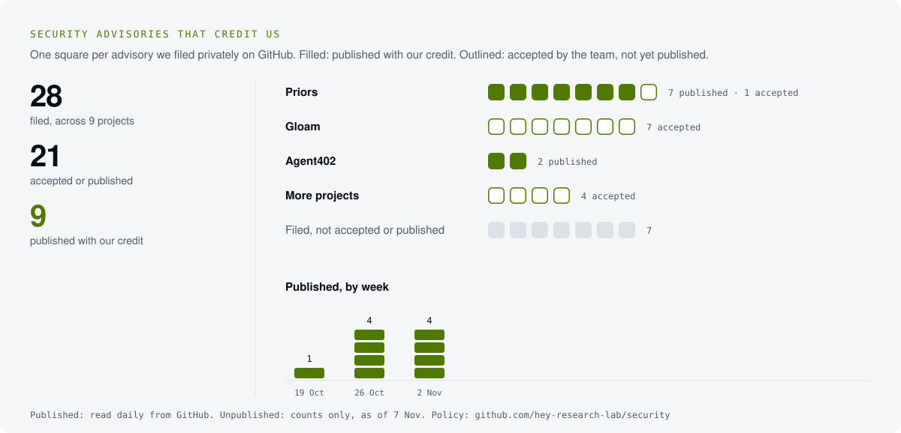
  </picture>
</a>

<b>Published advisories we found (11)</b>

| Project | Advisory | Severity | Our credit |
| --- | --- | --- | --- |
| [Hookr](https://github.com/Hookr-fun/hookr-contracts) | [GHSA-m3fx-pjvg-cmf7](https://github.com/Hookr-fun/hookr-contracts/security/advisories/GHSA-m3fx-pjvg-cmf7): the per-wallet launch cap counted per contract for router swaps, so one buyer could hold many caps | Low | Reporter |
| [Hookr](https://github.com/Hookr-fun/hookr-contracts) | [GHSA-43mv-935h-rpm7](https://github.com/Hookr-fun/hookr-contracts/security/advisories/GHSA-43mv-935h-rpm7): in the first-release time shares, a lock made after a drop could share in that drop | Low | Finder · fixed in the 29 Oct release |
| [Agent402](https://github.com/MikeyPetrillo/Agent402) | [GHSA-q7vw-c7hm-m885](https://github.com/MikeyPetrillo/Agent402/security/advisories/GHSA-q7vw-c7hm-m885): the x402 buyer signed the seller's `maxAmountRequired` while its spend caps checked `amount` | High | Reporter · fixed the same day |
| [Agent402](https://github.com/MikeyPetrillo/Agent402) | [GHSA-gcw5-6259-gh72](https://github.com/MikeyPetrillo/Agent402/security/advisories/GHSA-gcw5-6259-gh72): the Stellar settle fallback took any recent transfer from the payer to the treasury as payment | High | Reporter · fixed the same day |
| [Priors](https://github.com/priors-agents/priors) | [GHSA-cqcw-9qjc-5qc7](https://github.com/priors-agents/priors/security/advisories/GHSA-cqcw-9qjc-5qc7): in @priors/mcp 0.16.0, the Rialto route sent a quote's transaction data unchecked, so a quote could pay another address or drop the minimum | Medium | Reporter |
| [Priors](https://github.com/priors-agents/priors) | [GHSA-p29w-c8p2-qfm5](https://github.com/priors-agents/priors/security/advisories/GHSA-p29w-c8p2-qfm5): the elizaOS plugin let any room member make the agent pay x402 merchants and open loans | Low | Reporter |
| [Priors](https://github.com/priors-agents/priors) | [GHSA-4w7q-8vph-j5mr](https://github.com/priors-agents/priors/security/advisories/GHSA-4w7q-8vph-j5mr): a PT-USDG price tape resumed after the feed dropped its rounds held credit for about 15 days and seized the whole deposit on default | Low | Reporter |
| [Priors](https://github.com/priors-agents/priors) | [GHSA-jjxq-7r68-44m5](https://github.com/priors-agents/priors/security/advisories/GHSA-jjxq-7r68-44m5): Score v2 kept a market sale made after a plain transfer, carrying the intermediary's income | Low | Reporter |
| [Priors](https://github.com/priors-agents/priors) | [GHSA-qcrq-x8xg-25vg](https://github.com/priors-agents/priors/security/advisories/GHSA-qcrq-x8xg-25vg): the stock vault's `borrowRoom` quoted room the vault and pool refuse | Low | Finder · fixed in Priors' readers, listed as [SV-21](https://github.com/priors-agents/priors/blob/main/docs/SECURITY-v2.md) |
| [Priors](https://github.com/priors-agents/priors) | [GHSA-xccq-5ghg-w7mq](https://github.com/priors-agents/priors/security/advisories/GHSA-xccq-5ghg-w7mq): a V5 borrow over 10 days sent a transaction before it was refused | Low | Finder · fixed in @priors/x402 0.8.3 and @priors/mcp 0.12.1, listed as [P-49](https://github.com/priors-agents/priors/blob/main/docs/SECURITY-v2.md) |
| [Priors](https://github.com/priors-agents/priors) | [GHSA-3vg6-2f3m-j5qm](https://github.com/priors-agents/priors/security/advisories/GHSA-3vg6-2f3m-j5qm): a new PT-USDG price tape started at round 1 once the feed had dropped its old rounds | Low | Finder · fixed on chain, listed as [SV-20](https://github.com/priors-agents/priors/blob/main/docs/SECURITY-v2.md) |

<b>Teams that credited us in their own channels (4)</b>

| Team | What we reported | Credit |
| --- | --- | --- |
| Agraris | public listings could set their own GitHub stars, activity and dates, and links accepted any URL scheme (Low) | [commit 177e360](https://github.com/agrarisai/agraris/commit/177e360) · [post on X](https://x.com/agrarisai/status/2117276441310335355) |
| predict FWA (Sherwood arena) | two game-logic issues, found before launch (Low) | [security review in the README](https://github.com/MirakoolDev/sherwood#security-review-nov-2026) · [post on X](https://x.com/pfwafun/status/2117205853539353009) |
| LoomDesk (loomdesk-sdk) | four gaps in the SDK's send gate (Low) | [0.7.1, commit 2e97226](https://github.com/loomdesk-hq/sdk/commit/2e97226) |
| Gloam | eight items across the vault contracts, relay, SDK, MCP server and app (Low to Medium) | [joint post on X](https://x.com/HeyResearch/status/2117263881815118077) |

Maintain a Robinhood Chain project and want a second pair of eyes? Turn on
[private vulnerability reporting](https://docs.github.com/en/code-security/how-tos/report-and-fix-vulnerabilities/configure-vulnerability-reporting/configure-for-a-repository)
on your repository, and we report there.

## Use it

| | |
| --- | --- |
| **Check any token or project** | [heyresearch.xyz](https://heyresearch.xyz) · from a terminal: `npx @hey-research-lab/check '$TICKER'` |
| **Research Terminal** | HEY's research workspace: projects, what changed, a project's timeline and contracts, with market and on-chain figures as context. Anyone can open the preview; the full view needs Terminal access: [heyresearch.xyz/terminal](https://heyresearch.xyz/terminal) |
| **Telegram bot** | ask who is building a Robinhood Chain project, what shipped and where the evidence is, in a private chat, inline or in a group: [t.me/HeyResearch_Bot](https://t.me/HeyResearch_Bot). Community-run by HEY Research Lab · not an official Robinhood channel. |
| **Stock Tokens** | Robinhood's Stock Tokens on Robinhood Chain and the published projects that name them in their own code, with corporate actions announced and trading sessions from Robinhood's own feed: [heyresearch.xyz/stock-tokens](https://heyresearch.xyz/stock-tokens) |
| **Weekly builder report** | who shipped on Robinhood Chain this week, each ship with its source: [heyresearch.xyz/reports/weekly](https://heyresearch.xyz/reports/weekly) |
| **Public API** | one call per token: `GET /api/v1/builder?chain=4663&token=0x…` · [docs](https://heyresearch.xyz/developers) · [changelog](https://heyresearch.xyz/developers/changelog) |
| **Embed** | a live builder card on any site: `<hey-project contract="0x…">` · [embeds](https://heyresearch.xyz/developers) |
| **Token Passport** | a token's page credits the Robinhood Chain protocols whose facts HEY reads (a HoodLock lock, the launchpad that minted it, its Uniswap v4 hooks), each with a link: [heyresearch.xyz/passport](https://heyresearch.xyz/passport) |
| **Badge** | a project's live HEY badge for its site or README; projects showing one are thanked on [heyresearch.xyz/badges](https://heyresearch.xyz/badges) |
| **Open data** | daily snapshots and a weekly Hugging Face copy, CC BY 4.0: [below](#uniswap-v4-hooks-and-open-data) |

## Uniswap v4 hooks and open data

<!-- HOOKS:START -->
Of the **32,344 hook contracts** HEY has seen in Robinhood Chain's Uniswap v4 pools, **153** are tied to **70 published projects**, each with the evidence that ties it: on chain, an address linked to the project, the project's factory, or HEY's review. **[heyresearch.xyz/integrations/uniswap/hooks](https://heyresearch.xyz/integrations/uniswap/hooks)** · refreshed daily
<!-- HOOKS:END -->

We proposed to Uniswap's public hooklist an optional way to name the project behind a hook, with its public evidence,
starting with Robinhood Chain: [Uniswap/hooklist#10665](https://github.com/Uniswap/hooklist/issues/10665).

| | |
| --- | --- |
| **Daily snapshot** | [heyresearch.xyz/data](https://heyresearch.xyz/data): projects, ships and changes as NDJSON and CSV, and every hook the hooks page shows as `hooks.ndjson.gz` and `hooks.csv` |
| **Weekly on Hugging Face** | [heyresearch/robinhood-chain-builders](https://huggingface.co/datasets/heyresearch/robinhood-chain-builders): the newest `projects.csv`, `ships.csv` and `hooks.csv`, copied every Monday |
| **hey-data** | [hey-data](https://github.com/hey-research-lab/hey-data): `hey-data generate` builds a full snapshot from the public API, `hey-data hooks` copies the newest hooks file checked against its `SHA256SUMS`, `hey-data huggingface` writes the Hugging Face copy |

All of it is CC BY 4.0, with no price, market or holder field in any file.

## Open source

<b>Our public repositories</b>

| Repository | What it is |
| --- | --- |
| [awesome-robinhood-chain](https://github.com/hey-research-lab/awesome-robinhood-chain) | Projects building on Robinhood Chain, regenerated weekly from the open dataset |
| [hey-check](https://github.com/hey-research-lab/hey-check) | Dev check for any Robinhood Chain token: is anyone building it? A terminal answer and a shareable card |
| [chainprint](https://github.com/hey-research-lab/chainprint) | Offline scan of a source tree for evidence that the code targets Robinhood Chain, with a confidence anyone can recompute |
| [rhchain-registry](https://github.com/hey-research-lab/rhchain-registry) | A CI-validated registry of Robinhood Chain infrastructure, a public source for every entry |
| [hey-cli](https://github.com/hey-research-lab/hey-cli) | HEY's research from the terminal |
| [hey-ship-action](https://github.com/hey-research-lab/hey-ship-action) | A GitHub Action that writes evidence linking a commit or release to a Robinhood Chain deployment |
| [hey-agent-skills](https://github.com/hey-research-lab/hey-agent-skills) | An Agent Skill and Claude Code plugin for builder research |
| [hey-agentkit](https://github.com/hey-research-lab/hey-agentkit) · [hey-goat-plugin](https://github.com/hey-research-lab/hey-goat-plugin) · [hey-virtuals-plugin](https://github.com/hey-research-lab/hey-virtuals-plugin) · [plugin-hey-research](https://github.com/hey-research-lab/plugin-hey-research) | HEY's builder research as tools for Coinbase AgentKit, GOAT, Virtuals GAME and ElizaOS agents, each on npm |
| [robinhood-chain-starter](https://github.com/hey-research-lab/robinhood-chain-starter) | A Foundry and viem starter for Robinhood Chain (4663): a contract, tests, deploy and Multicall3 read scripts |
| [hey-data](https://github.com/hey-research-lab/hey-data) | Research snapshots of HEY's public builder records as NDJSON, the hooks file and the Hugging Face copy |
| [proof-of-ship](https://github.com/hey-research-lab/proof-of-ship) | A $WIF bounty escrow on Robinhood Chain that pays a builder when HEY signs that it counted real ships |
| [proof-of-ship-near](https://github.com/hey-research-lab/proof-of-ship-near) | The same escrow on NEAR, in USDC, verifying HEY's signature on chain with `ecrecover` |
| [hey-research-open](https://github.com/hey-research-lab/hey-research-open) | The open part of the platform: SDK, MCP server, scoring and source adapters |
| [hey-embed](https://github.com/hey-research-lab/hey-embed) | A dependency-free `<hey-project>` web component, with a React wrapper, to embed a project's builder evidence |
| [hey-telegram-bot](https://github.com/hey-research-lab/hey-telegram-bot) | A self-hostable, read-only Telegram bot for HEY lookups, powered only by the public API |
| [hey-agent-contract](https://github.com/hey-research-lab/hey-agent-contract) | The public contract of HEY's agent answers: schemas, types, fixtures and test vectors |
| [hey-project-manifest](https://github.com/hey-research-lab/hey-project-manifest) | `/.well-known/hey-project.json`, a format for a project to declare its repos, contracts and sites |
| [hey-research-receipts](https://github.com/hey-research-lab/hey-research-receipts) | A spec and validator for what an agent cited and concluded about a project |
| [security](https://github.com/hey-research-lab/security) | How we report security issues to Robinhood Chain projects, and the teams that fixed them |
| [hey-edge-probe](https://github.com/hey-research-lab/hey-edge-probe) | An hourly outside check of heyresearch.xyz against our own performance budget |

Every public repository, including data snapshots, embeds and agent-framework plugins:
[github.com/hey-research-lab](https://github.com/hey-research-lab?tab=repositories&type=source).
Small, well-described issues are labelled
[good first issue](https://github.com/search?q=user%3Ahey-research-lab+label%3A%22good+first+issue%22+state%3Aopen&type=issues).
Found a security issue in one of our repositories? Write to hi@heyresearch.xyz or [x.com/HeyResearch](https://x.com/HeyResearch).

Community-run by HEY Research Lab · not affiliated with or endorsed by Robinhood, Base, Uniswap Labs, Hugging Face, NEAR or any other project named here · a HEY badge is verified from
public evidence, not a Robinhood certification · not investment advice.

